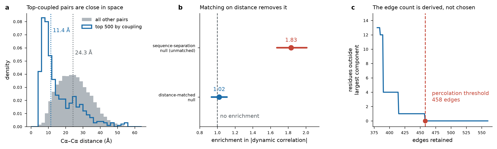

# EVODYN

**Evolutionary, structural and dynamic datasets of protein allostery.**

[-orange)](#status)
[](LICENSE)

EVODYN turns a protein family and a structure into a consistent, multi-layer
dataset: co-evolutionary couplings, a residue interaction network and its
community structure, molecular dynamics and the correlations it produces, and
the geometry and secondary structure that both have to be controlled against.
One configuration file, one command, two tables in canonical numbering.

It is a generalisation of a single-protein study of the EGFR kinase domain
([EGFRAllostery](https://github.com/rkibler88/EGFRAllostery)), built so that the
analysis can be run over many proteins rather than one — a case study turned
into a dataset generator.



*The reason the controls are built in rather than bolted on. (**a**) In the EGFR
alignment, the top-coupled "distal" pairs sit at a median 11.4 Å Cα–Cα against
24.3 Å for the rest — a sequence-separation filter does not control for spatial
proximity. (**b**) Against a sequence-separation null, co-evolving pairs show
1.83-fold enrichment in correlated motion; against a distance-matched null the
same pairs give 1.02-fold, with a bootstrap interval spanning 1.0. (**c**) The
network's edge count is located from the coupling distribution rather than
chosen. All three panels are produced by `evodyn run` on the shipped example.*

---

## Status

**v0.1.0 — alpha, work in progress.** The analysis core (numbering, network,
controls, tables, reporting) is implemented and tested, and reproduces the EGFR
case study exactly. The stages that shell out to external tools — alignment
retrieval, CD-HIT, plmc, EquilibraTor/GROMACS, pySCA — are implemented but have
so far been exercised only on the EGFR configuration and in dry-run form. See
[docs/ROADMAP.md](docs/ROADMAP.md) for what is finished, what is untested and
what is missing.

## Install

```bash
git clone https://github.com/rkibler88/EVODYN.git
cd EVODYN
conda env create -f environment.yml
conda activate evodyn
pip install -e .
```

The core needs only the Python scientific stack. Stages that need an external
program say so, and `evodyn plan` tells you which ones you have:

| stage | external tool | needed for |
|---|---|---|
| sequences | `cd-hit` | redundancy filtering |
| coevolution | `plmc` | direct coupling analysis |
| coevolution | pySCA | sector decomposition (optional) |
| dynamics | [`EquilibraTor`](https://github.com/Dias-Lab/EquilibraTor) + GROMACS | running the simulations |
| structure | `mdtraj`, DSSP | secondary structure |

## Run

```bash
evodyn validate -c config.yaml   # check the configuration
evodyn plan     -c config.yaml   # what would run, and the exact MD command
evodyn run      -c config.yaml   # the pipeline
evodyn benchmark                 # reproduce the EGFR case study
```

The shipped example reproduces the EGFR analysis from committed intermediates
in about two seconds, with no external tools:

```console
$ cd examples/egfr && evodyn run -c config.yaml

EVODYN 0.1.0 - EGFR_kinase
  + sequences       0.1s  253 scored positions (focus region spans 257)
  + coevolution     0.0s  31878 pairs, 55.5% negative
  + network         1.1s  253 nodes, 462 edges, 15 communities, Q = 0.8036
  + dynamics        0.4s  precomputed matrix, 253 residues
  + structure       0.0s  253 residues; 92% of network edges are contacts (median 3.9 A)
  + controls        0.4s  none: 1.83; ca_distance: 1.02
  + export          0.2s  residues.csv.gz, pairs.csv.gz
```

## What a run produces

| file | contents |
|---|---|
| `residues.csv.gz` | one row per scored residue: amino acid, conservation, community, centrality and rank, RMSF, secondary structure, site membership |
| `pairs.csv.gz` | one row per scored pair: coupling, sequence separation, Cα–Cα distance, contact flag, dynamic correlation, community pair, network-edge flag |
| `enrichment.csv` | every enrichment statistic with each of its matched nulls and bootstrap intervals |
| `network_nodes.csv`, `network_edges.csv`, `intermodule_coupling.csv` | the network, its partition and inter-module coupling over edges |
| `report.md` | what ran, what came out, and **what this run does not support** |
| `manifest.json` | resolved configuration, package and binary versions, SHA-256 of every input and output, per-stage timings |

Both tables use the same column names for every protein, in the reference
protein's own numbering, so a study over many targets is a concatenation.

## Design

Four commitments, each of which exists because the EGFR study got bitten by its
absence. [docs/DESIGN.md](docs/DESIGN.md) gives the longer version.

1. **Controls are stages, not options.** Every enrichment is reported with its
   matched nulls beside it — distance-matched, conservation-matched,
   secondary-structure-matched. An unmatched enrichment is never reported
   alone, because the EGFR result that survived review and the one that did not
   differ only in which null was used.
2. **Numbering is asserted, not assumed.** Alignment columns, canonical residue
   numbers and structure numbering are three different coordinate systems.
   EVODYN maps between them once, detects the structure's numbering offset by
   comparing residue identities, and stops the run when they disagree.
3. **Every run states its own limits.** `report.md` ends with a limits section
   written by the stages themselves: the alignment's taxonomic composition, how
   much of the network is just a contact map, what the dynamics did and did not
   sample, whether a matched null removed the effect.
4. **Thresholds are derived where they can be.** The network edge count is
   located by percolation rather than chosen; Louvain is run over many seeds and
   the winning seed is recorded.

## Dynamics

EVODYN runs molecular dynamics rather than requiring you to bring a trajectory,
by delegating to **[EquilibraTor](https://github.com/Dias-Lab/EquilibraTor)**
(Dias Lab), which drives GROMACS from topology generation through solvation,
ion placement, minimisation, NVT, NPT, convergence detection and production.
Four modes:

| `dynamics.mode` | what happens |
|---|---|
| `equilibrate` | EVODYN runs the MD through EquilibraTor, one replicate per directory |
| `trajectory` | EVODYN analyses a trajectory you already have (testing, published simulations, facility-run MD) |
| `matrix` | EVODYN consumes a precomputed correlation matrix |
| `none` | no dynamic layer, and the report says so |

## Authors

Ryan Kibler and Raquel Dias, PhD — Department of Microbiology and Cell Science,
University of Florida.

## Tools EVODYN invokes, and who built them

EVODYN is a pipeline, not a reimplementation. Each stage below runs someone
else's program; **if you use the stage, cite the tool.** The machine-readable
list is in [CITATION.cff](CITATION.cff) and
[paper/paper.bib](paper/paper.bib).

| stage | tool | authors |
|---|---|---|
| dynamics (`mode: equilibrate`) | [EquilibraTor](https://github.com/Dias-Lab/EquilibraTor) — GROMACS setup-to-production workflow | José D. D. Cediel-Becerra, Jose Cleydson F. Silva, Raquel Dias ([CSBJ **27**, 5318–5325, 2025](https://doi.org/10.1016/j.csbj.2025.11.034)) |
| export (`spheronizator`) | [Spheronizator](https://github.com/Dias-Lab/spheronizator) — voxelises structures for machine learning | Matthew Richardson, Jose Cleydson F. Silva, José D. D. Cediel-Becerra, Raquel Dias |
| export (`interactor`) | [InteracTor](https://github.com/Dias-Lab/InteracTor) — physics-based interaction features | Jose Cleydson F. Silva, Layla Schuster, Nick Sexson, Melissa Erdem, Ryan Hulk, Matias Kirst, Marcio F. R. Resende, Raquel Dias ([2025](https://doi.org/10.1101/2025.04.10.648139), [2024](https://doi.org/10.1101/2024.10.07.616705)) |
| coevolution | [plmc](https://github.com/debbiemarkslab/plmc) — pseudo-likelihood DCA | Hopf, Ingraham, Poelwijk, Schärfe, Springer, Sander, Marks |
| coevolution (sectors) | [pySCA](https://github.com/ranganathanlab/pySCA) — statistical coupling analysis | Rivoire, Reynolds, Ranganathan |
| sequences | [CD-HIT](https://github.com/weizhongli/cdhit) — redundancy filtering | Fu, Niu, Zhu, Wu, Li |
| dynamics | [GROMACS](https://www.gromacs.org) | Abraham, Murtola, Schulz, Páll, Smith, Hess, Lindahl |
| dynamics, structure | [MDTraj](https://mdtraj.org) | McGibbon *et al.* |

The three Dias Lab tools above — EquilibraTor, Spheronizator and InteracTor —
are what let EVODYN run molecular dynamics and emit machine-learning-ready
features without reimplementing either.

## Citing

See [CITATION.cff](CITATION.cff). A software paper is in preparation; the draft
is in [paper/paper.md](paper/paper.md). Code is MIT.

The case study EVODYN generalises:
[rkibler88/EGFRAllostery](https://github.com/rkibler88/EGFRAllostery).
